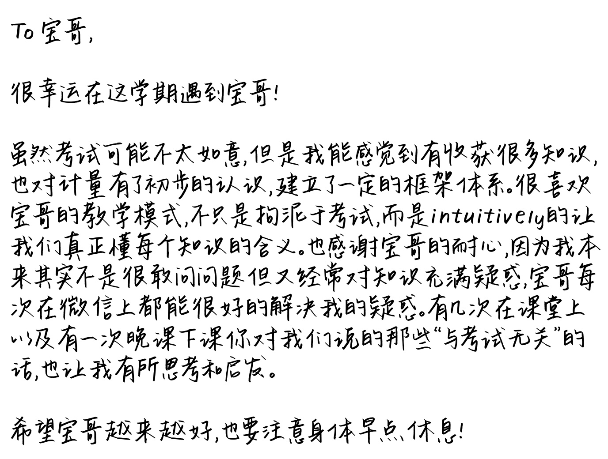
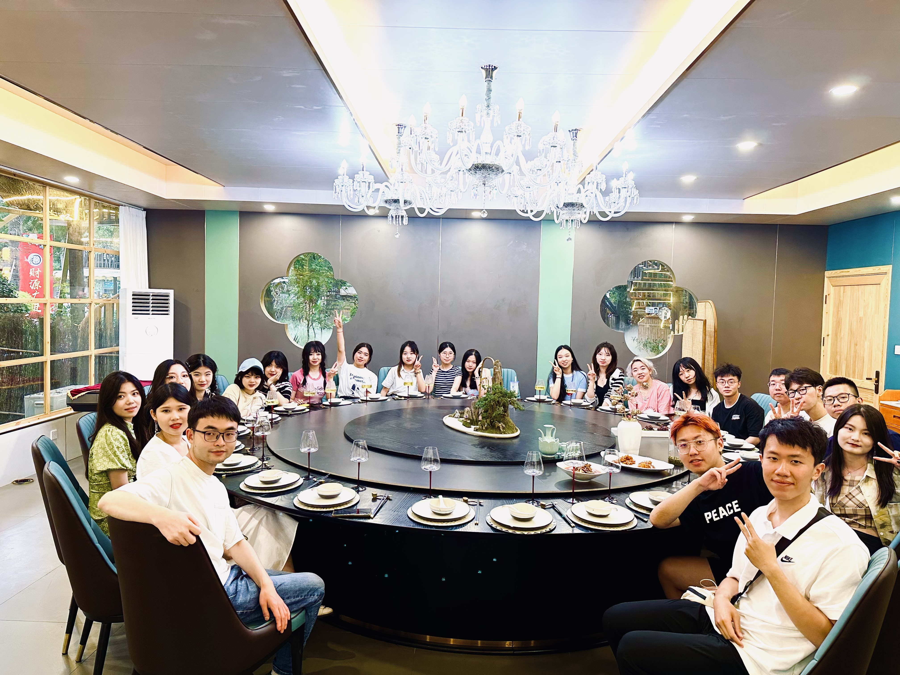
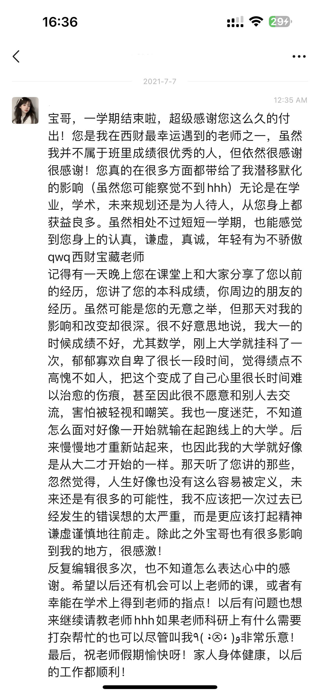
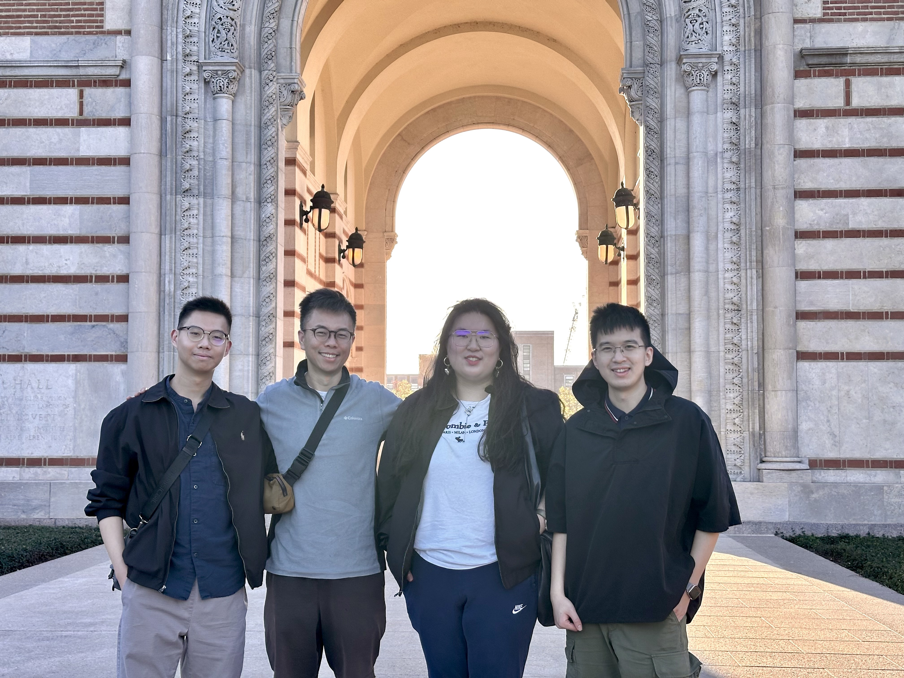
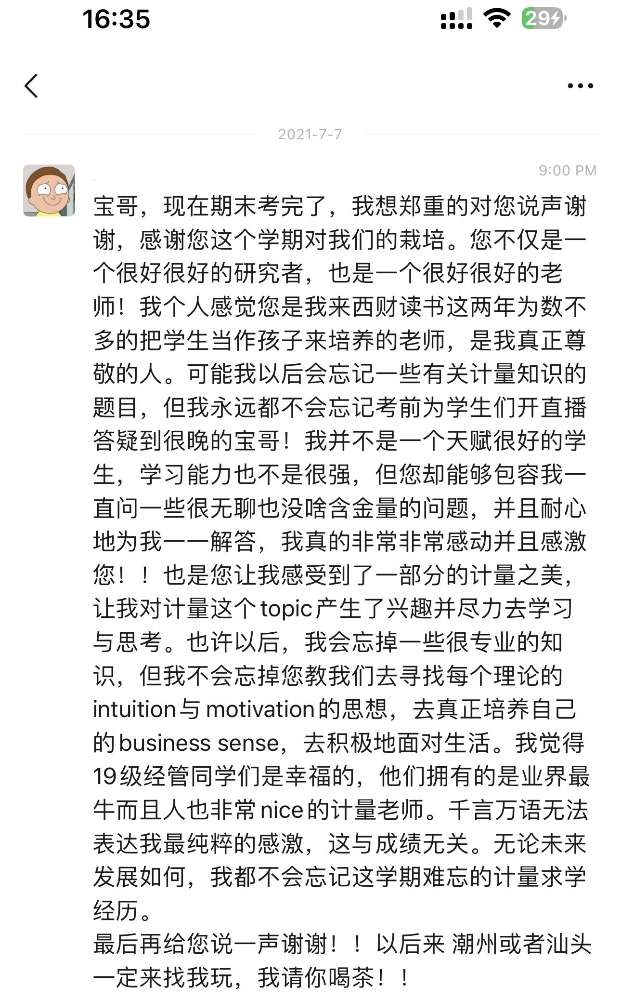
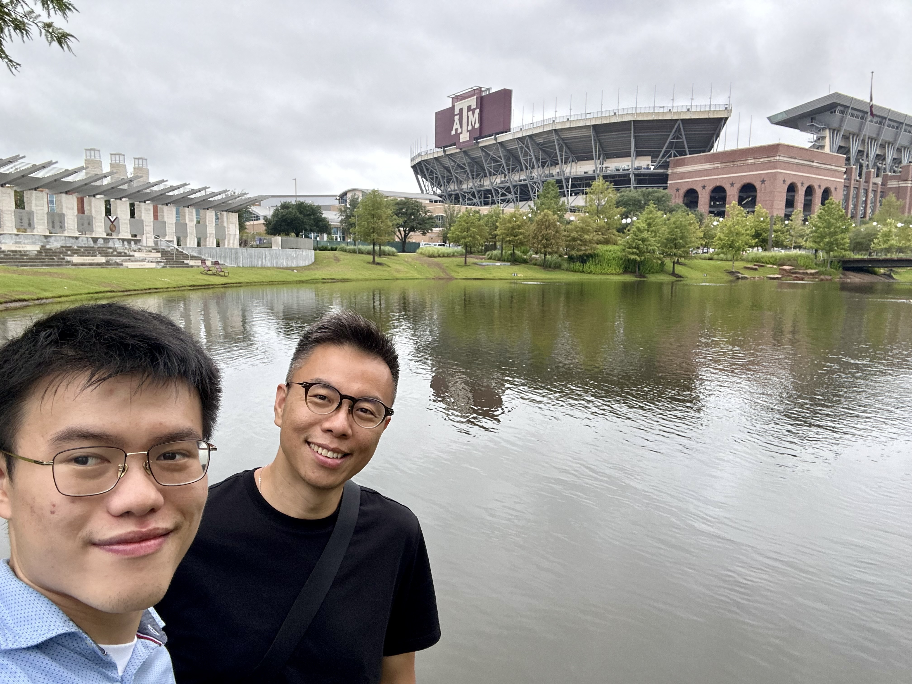
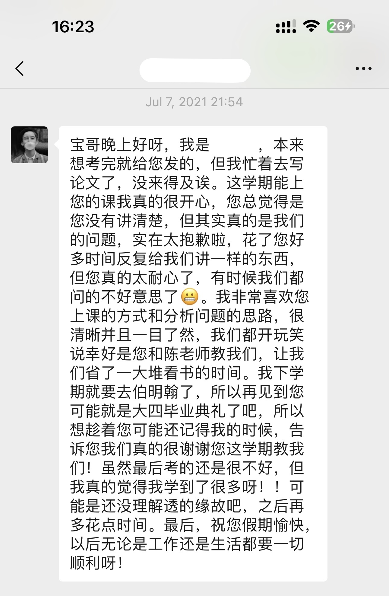

<nav class="fs-sidenav" aria-label="Former students sections">
  
<a href="/former_students">Former students</a>

  <ul>
    <li><a href="/former_students/graduate">Graduate Advising</a></li>
    <li><a href="/former_students/undergraduate">Undergraduate Advising</a></li>
  </ul>
</nav>

  <button class="fs-mobile-toggle" type="button" aria-label="Open advising menu" aria-expanded="false" onclick="var n=this.parentNode;var o=n.classList.toggle('open');this.setAttribute('aria-expanded',o?'true':'false');">
    
  </button>
  

    <a href="/former_students/graduate">Graduate Advising</a>
    <a href="/former_students/undergraduate">Undergraduate Advising</a>
  

  <blockquote id="fs-quote">
    &ldquo;Students don't care how much you know until they know how much you care.&rdquo;
    <cite id="fs-quote-cite">— John C. Maxwell</cite>
  </blockquote>

  

    <!-- Slide 1: group photo -->
    

      

        
        
With my students at RIEM, SWUFE.

      

    

    <!-- Slide 2: comment 1 (anonymous handwritten letter) -->
    

      

        
      

      

        <h4>A note from a student — English translation</h4>

        
To Bao ge,

        
How lucky I was to meet you this semester!

        
Although my exam may not have gone as well as I'd hoped, I could feel that I gained a lot — I've developed an initial understanding of econometrics and built a certain framework. I really like your teaching style: not just constrained by exams, but <em>intuitively</em> letting us truly understand the meaning of every concept.

        
I also want to thank you for your patience — I'm actually not someone who's very comfortable asking questions, but I often have doubts about the material. Every time I asked you on WeChat, you were able to resolve my confusion. And the things you told us in class and one evening after class, "unrelated to exams," also gave me a lot to think about.

        
I hope you continue to do better and better, and please take care of your health and rest earlier!

      

    

    <!-- Slide 3: group photo — students at RIEM -->
    

      

        
        
With my students at RIEM, SWUFE.

      

    

    <!-- Slide 4: comment 2 (Wu Junqing) -->
    

      

        
      

      

        <h4>A note from a student — English translation</h4>
        
Bao ge, the semester is over — thank you so much for everything you've done for us! You are one of the teachers I've been luckiest to meet at SWUFE. Although I'm not among the top students in class, I'm still deeply grateful. You've influenced me in so many ways — perhaps without even realizing it — in academics, in research, in future planning, in how to treat people. Even in one short semester, I could feel your seriousness, humility, sincerity, and quiet confidence. A true "treasure teacher" of SWUFE.

        
I remember one evening you shared your past experiences with the class — your undergraduate grades, your friends' journeys. It might have been unintentional, but it had a very deep impact on me. My freshman year didn't go well, especially in math — I failed a course right after starting university. For a long time I felt down and inferior, thinking my GPA was too low, and this became a wound that was hard to heal. I even became reluctant to socialize, afraid of being looked down on. I felt lost, not knowing how to face a college experience where I'd already lost at the starting line. Slowly I got back up — my college life felt like it truly began in sophomore year.

        
Hearing what you said that evening, I suddenly felt that life isn't so easily defined — the future still holds many possibilities. I shouldn't take one past mistake too seriously. Instead, I should move forward with spirit and humility.

        
I've edited this message many times but still don't know how to fully express my thanks. I hope one day I'll have the chance to take your class again, or to receive your academic guidance. If you ever need help with anything in your research, feel free to call on me.

        
Finally, wishing you a pleasant vacation, good health for you and your family, and all the best in your work ahead!

      

    

    <!-- Slide 5: group photo — Munich / Boston / LA visit -->
    

      

        
        
Former students visiting from Munich, Boston, and LA.

      

    

    <!-- Slide 6: comment 3 (Chen Boyuan, now MS at Boston University) -->
    

      

        
      

      

        <h4>A note from a student — English translation</h4>
        
Bao ge, now that the final exam is over, I want to sincerely say thank you for everything you did for us this semester. You are not just a very, very good researcher, but also a very, very good teacher! In my two years at SWUFE, you are one of the few teachers I've felt truly nurtured students as if they were your own children — someone I genuinely respect.

        
I may forget some econometrics questions in the future, but I'll never forget you streaming live before the exam, answering our questions late into the night. I'm not a naturally gifted student, and my learning ability isn't strong, but you tolerated me asking simple, low-value questions and patiently answered them one by one. I'm really, really moved and grateful.

        
You also let me feel some of the beauty of econometrics — you made me genuinely interested in the topic and willing to put in effort to study and think about it. I may forget some technical knowledge over time, but I won't forget that you taught us to look for the <em>intuition</em> and <em>motivation</em> behind every theory, to develop real business sense, and to face life actively.

        
I feel the students of Class 2019 Econ &amp; Mgmt are lucky — we had an econometrics teacher who is top-notch in the field and also a truly kind person. A thousand words cannot express my purest gratitude, and this has nothing to do with grades. No matter how my future unfolds, I'll never forget this unforgettable semester of studying econometrics with you.

        
Thank you once again for this unforgettable semester!

      

    

    <!-- Slide 7: group photo — UK visit -->
    

      

        
        
A former student visiting from London.

      

    

    <!-- Slide 8: comment 4 (Zeng Qiguo, went on to Birmingham) -->
    

      

        
      

      

        <h4>A note from a student — English translation</h4>
        
Good evening Bao ge! I meant to message you right after the exam, but I was busy writing a paper — sorry for the delay!

        
I'm really happy I got to take your class this semester. You often felt you hadn't explained things clearly, but honestly the fault was ours — I'm sorry we made you spend so much time explaining the same things again and again. You were incredibly patient — sometimes we felt embarrassed to keep asking 😬.

        
I love your teaching style and analytical approach — clear and intuitive. We joked that we were lucky to have you and Prof. Chen teaching us; it saved us a huge amount of reading time.

        
Next semester I'll be leaving for Birmingham, so the next time I see you might not be until senior graduation. So I wanted to tell you now, while you probably still remember me — we really are grateful for you teaching us this semester. My exam still didn't go well, but I really feel I learned a lot!

        
Finally, wishing you a happy vacation, and all the best in both work and life going forward!

      

    

  

  <button class="fs-carousel-arrow prev" id="fs-prev" aria-label="Previous slide">‹</button>
  <button class="fs-carousel-arrow next" id="fs-next" aria-label="Next slide">›</button>

  

  <button class="fs-music" id="fs-music" type="button" aria-label="Play background music" title="Play background music">🎵</button>

  

